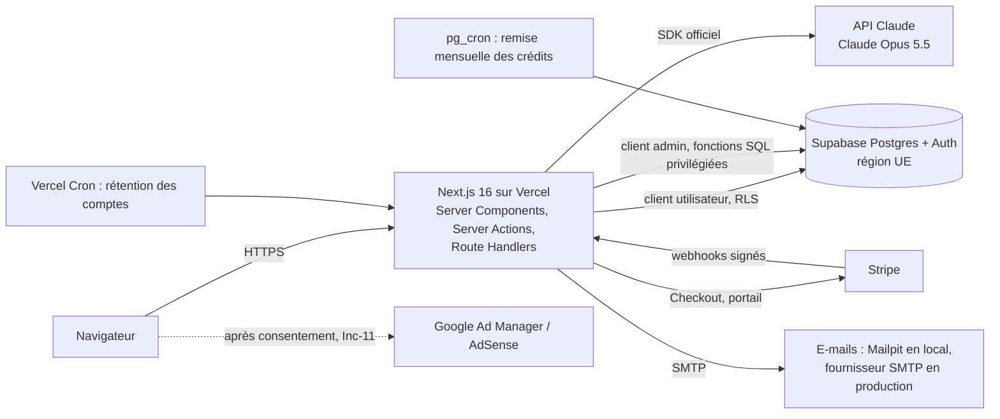

# Architecture — Mon CV en 30 Secondes (version Web)

> Phase 3 — rôle Solution Architect. Date : 23/11/2026.
> Décisions : `DECISION_LOG.md` ADR-009 à ADR-019. Contrats et flux détaillés :
> `docs/system-design.md`. Données : `docs/data-model.md`. Design : `docs/design/`.

---

## 1. Vue d'ensemble



Principe : **une seule application Next.js** (pas de microservices). Toute logique métier et toute
écriture sensible s'exécutent côté serveur ; le navigateur n'a jamais de secret.

---

## 2. Stack et versions

Versions relevées sur le registre npm le 23/11/2026, épinglées dans `package.json` à l'Inc-0.

| Rôle | Choix | Version |
|------|-------|---------|
| Framework | Next.js (App Router, Cache Components), React | 16.4.6, 19.3.1 |
| Langage | TypeScript, mode strict | 6.0.3 (typescript-eslint n'accepte pas encore la 7, ADR-020) |
| Style | Tailwind CSS + shadcn/ui (sur Base UI), icônes Lucide | 4.3.5, CLI 4.23.0, 1.78.0 |
| Validation | Zod | 4.6.x |
| Internationalisation | next-intl (routage par langue, chemins traduits, messages typés) | 4.15.x |
| État serveur côté client | TanStack Query (usage limité, voir §4) | 5.108.x |
| Base, Auth | Supabase (`@supabase/supabase-js`, `@supabase/ssr`), CLI en dépendance du projet | 2.119.x, 0.12.x, CLI 3.2.x |
| IA | `@anthropic-ai/sdk` | 1.6.0 (ADR-027) |
| Paiement | `stripe` (serveur uniquement), CLI Stripe dans Docker | 23.1.0, CLI v1.55.8 (ADR-029) |
| Exports | `@react-pdf/renderer`, `docx`, police Arimo | 4.9.0, 9.15.3 (ADR-028) |
| Notifications | `sonner` | 2.0.x |
| Tests | Vitest, Playwright | 5.1.x, 1.65.x |
| Qualité | ESLint (configuration Next.js), Prettier, simple-git-hooks + lint-staged, @axe-core/playwright | 9.39.5 (ADR-020), 3.10.1 |
| Hébergement | Vercel ; Supabase (UE) | — |

Écarts assumés par rapport à la stack par défaut (ADR-009) : pas de bibliothèque de formulaires
(Server Actions + `useActionState` + Zod suffisent) ; TanStack Query limité aux besoins réels
(attente de confirmation de paiement ; l'éditeur s'en passe, ADR-027).

---

## 3. Organisation du code (feature-first)

Les sous-dossiers `domain / data / application / presentation` ne sont créés que s'ils
contiennent quelque chose.

```
src/
├── app/                                  # routes uniquement (fines, délèguent aux features)
│   ├── [locale]/                         # fr, en, it, es, de (chemins traduits, §16)
│   │   ├── (marketing)/                  # accueil, tarifs, pages légales
│   │   ├── (auth)/connexion/             # connexion e-mail + Google
│   │   ├── creer/                        # assistant 5 questions + génération
│   │   ├── (app)/cv/                     # historique, [id] aperçu/éditeur et outils IA
│   │   └── (app)/compte/                 # profil, crédits et formule
│   ├── auth/callback/route.ts            # retour de Google (OAuth)
│   ├── auth/confirm/route.ts             # lien de secours de l'e-mail de connexion
│   ├── api/stripe/webhook/route.ts
│   ├── api/cv/[id]/export/route.ts       # PDF / DOCX
│   ├── api/cron/retention/route.ts
│   ├── layout.tsx, error.tsx, not-found.tsx, global-error.tsx
│   ├── robots.ts, sitemap.ts
├── features/
│   ├── auth/            # actions de connexion, garde de session
│   ├── profile/         # profil, suppression du compte, rétention
│   ├── plans/           # offres, prix, quotas, matrice des droits (domaine pur, source unique)
│   ├── credits/         # solde, débit, remboursement (appels aux fonctions SQL)
│   ├── cv/              # schéma du CV, dépôt, génération, éditeur
│   ├── ai/              # client Claude, prompts, schémas de sortie, journal des coûts
│   ├── ai-tools/        # amélioration, adaptation, LinkedIn, lettre, entretien (Inc-7 à 9)
│   ├── export/          # rendu PDF et DOCX
│   ├── billing/         # Stripe : checkout, portail, traitement des webhooks
│   └── ads/             # consentement, emplacements, vidéo récompensée (Inc-11)
├── components/
│   ├── ui/              # composants shadcn/ui
│   └── layout/          # en-tête, pied de page, navigation
├── i18n/                # langues, chemins traduits, chargement des messages, navigation
├── lib/
│   ├── supabase/        # server.ts, admin.ts, cookie-options.ts, database.types.ts
│   └── utils.ts
└── core/
    ├── env.ts           # lecture et validation Zod des variables d'environnement
    ├── action-result.ts # format commun des réponses d'actions
    └── errors.ts        # codes d'erreur et messages français
supabase/
├── config.toml          # services inutiles désactivés (ADR-007)
├── migrations/          # une ou plusieurs migrations par incrément
├── seed.sql             # comptes et données de développement
└── templates/           # e-mail de connexion (code + lien), un bloc par langue
messages/                # fr.json (référence), en.json, it.json, es.json, de.json
scripts/stripe-seed.mts  # crée produits, prix (lookup keys) et configuration du portail en mode test
tests/unit/              # Vitest, logique pure
tests/db/                # Vitest contre Supabase local : RLS et fonctions SQL
tests/e2e/               # Playwright (ordinateur et mobile)
docker-compose.yml       # CLI Stripe pour relayer les webhooks en local
```

Règles : `plans` ne dépend de rien ; aucune feature n'importe la couche `presentation` d'une
autre ; tout module serveur sensible commence par `import "server-only"`.

---

## 4. Stratégie de rendu par route

| Route | Contenu | Rendu | Pourquoi |
|-------|---------|-------|----------|
| `/` | Accueil | Statique | SEO, performance ; prix lus depuis `features/plans` (pas de base) |
| `/tarifs` | Offres | Statique | Idem |
| `/mentions-legales`, `/cgv`, `/confidentialite`, `/cookies` | Légal | Statique | Informations vendeur lues dans les variables d'environnement au build |
| `/connexion` | Connexion | Dynamique | Paramètre `next`, état de session |
| `/creer` | Assistant 5 questions | Statique + composant client | Aucune donnée serveur ; brouillon dans le navigateur |
| `/creer/generation` | Lancement de la génération | Dynamique, connecté | Session, droits, crédits |
| `/cv`, `/cv/[id]`, `/cv/[id]/*` | Historique, aperçu, outils | Dynamique, connecté, `noindex` | Données personnelles, jamais mises en cache partagé |
| `/compte`, `/compte/credits` | Compte, crédits | Dynamique, connecté, `noindex` | Idem |
| `api/*` | Webhook, export, cron | Route Handlers, runtime Node.js | Corps brut (signature Stripe), flux de fichiers, secret de cron |

Toutes les pages sont préfixées par la langue (`/fr`, `/en`, `/it`, `/es`, `/de`) avec des
chemins traduits (ex. `/fr/tarifs`, `/en/pricing`, `/it/prezzi`) ; les routes ci-dessus sont
écrites en français par commodité. Les pages statiques sont générées pour chacune des 5 langues.

Composants serveur par défaut ; composants client seulement pour l'interactivité (assistant,
éditeur, boîtes de dialogue, bascule mensuel/annuel, vidéo récompensée).

---

## 5. Frontières client / serveur et secrets

| Variable | Où | Usage |
|----------|-----|-------|
| `NEXT_PUBLIC_SITE_URL` | Client + serveur | URLs absolues (retours Stripe, OAuth, e-mails) |
| `NEXT_PUBLIC_SUPABASE_URL`, `NEXT_PUBLIC_SUPABASE_PUBLISHABLE_KEY` | Client + serveur | Clé publique soumise à la RLS |
| `SUPABASE_SECRET_KEY` | **Serveur uniquement** (`lib/supabase/admin.ts`) | Écritures privilégiées via fonctions SQL ; jamais importée côté client |
| `GOOGLE_AUTH_ENABLED` | Serveur | Affiche le bouton Google une fois le fournisseur activé (tâche 5) |
| `ANTHROPIC_API_KEY`, `ANTHROPIC_MODEL` (défaut `claude-opus-5-5`) | Serveur | Génération IA |
| `STRIPE_SECRET_KEY`, `STRIPE_WEBHOOK_SECRET` | Serveur | Paiements, vérification des webhooks |
| `CRON_SECRET` | Serveur | Protection de `/api/cron/*` |
| `IP_HASH_SALT` | Serveur | Hachage des adresses IP (H27) |
| `SMTP_HOST`, `SMTP_PORT`, `SMTP_USER`, `SMTP_PASSWORD`, `MAIL_FROM` | Serveur | E-mails d'avertissement de rétention |
| `ADS_ENABLED`, `ADS_REMOVAL_ENABLED`, identifiants des blocs publicitaires | Client + serveur | Inc-11 |
| `LEGAL_*` (raison sociale, SIRET, adresse…) | Build | Pages légales ; le build de production échoue si une valeur manque (US-38) |

Les noms exacts des clés Supabase sont confirmés par `supabase status` à l'Inc-0. `core/env.ts`
valide toutes les variables au démarrage et refuse de démarrer si une variable requise manque.

**Clients Supabase :**
1. **Navigateur** : aucun (ADR-022). Toutes les opérations passent par le serveur, ce qui permet
   des cookies de session `HttpOnly`.
2. **Serveur utilisateur** (`server.ts`) : cookies de session, soumis à la RLS ; utilisé pour
   toute lecture et toute modification autorisée à l'utilisateur.
3. **Admin** (`admin.ts`, serveur uniquement) : clé secrète ; utilisé seulement par les cas
   d'usage qui doivent écrire ce que l'utilisateur n'a pas le droit d'écrire lui-même (crédits,
   abonnements, achats, création de CV après génération), et toujours via des fonctions SQL
   dédiées ou des requêtes explicitement filtrées par l'identifiant vérifié.

---

## 6. Authentification

- Supabase Auth via `@supabase/ssr` (session en cookies HttpOnly).
- **Code à 6 chiffres reçu par e-mail** (l'utilisateur reste dans le même onglet), avec le lien
  de connexion en secours dans le même e-mail ; **Google OAuth**. Pas de mot de passe.
- Le fichier de proxy de Next.js 16 (ex-`middleware`) rafraîchit la session et redirige les
  routes privées vers `/connexion?next=…`. Chaque page et chaque action privée revérifie
  l'utilisateur côté serveur : le proxy n'est jamais la seule barrière.
- À la première connexion, un déclencheur SQL crée le profil et le portefeuille de crédits.
- Le brouillon des 5 questions est stocké dans le `localStorage` du navigateur (il survit au
  passage par Google ou par l'e-mail ouvert dans un autre onglet), puis effacé dès que le CV est
  enregistré.

Flux détaillés : `docs/system-design.md` §3.

---

## 7. IA

- Module `features/ai` : un client unique, un prompt et un **schéma de sortie Zod** par
  opération ; sorties structurées validées avant tout enregistrement.
- Modèle `claude-opus-5-5` (ADR-006), **effort `low`** (réglé explicitement : le défaut du
  modèle est `medium`), réponse en flux côté serveur pour éviter les délais d'attente HTTP,
  délai maximal de 60 s, une seule nouvelle tentative sur erreur transitoire.
- **Repli automatique côté serveur** (`fallbacks: "default"`) si le modèle refuse une requête ;
  le motif d'arrêt est toujours contrôlé avant de lire la réponse.
- Prompt système stable placé en tête pour bénéficier du cache de prompt quand sa taille le
  permet ; les données de l'utilisateur et le texte des annonces sont encadrés comme **données**,
  jamais comme instructions (anti-injection, R06).
- Chaque appel est journalisé dans `ai_operations` : opération, statut, crédits, tokens, coût
  estimé, durée (NFR-07).
- Syntaxe du SDK vérifiée dans la documentation officielle et ses types (Inc-4, ADR-027).
- Sans clé d'API, l'IA est **simulée** (développement, tests, CI) ; la clé est obligatoire en
  production.

---

## 8. Paiements

- **Stripe Checkout** pour tous les achats (mode paiement : packs, CV Pro, retrait des pubs ;
  mode abonnement : formules, essai de 3 jours) et **portail client Stripe** pour changer de
  formule, de moyen de paiement ou résilier.
- Prix identifiés par **lookup keys** (`credits_5`, `pro_month`…), TTC ; créés en mode test par
  `scripts/stripe-seed.mts` (`npm run stripe:seed`), qui configure aussi le portail (montée immédiate au prorata,
  descente et résiliation en fin de période).
- Renonciation au droit de rétractation recueillie par Stripe Checkout (acceptation des
  conditions obligatoire, avec un texte dédié), puis copiée dans la table `purchases`.
- **Webhook** `/api/stripe/webhook` : signature vérifiée, idempotence par identifiant
  d'événement, état d'abonnement relu depuis Stripe à chaque événement (ordre indifférent).
- En local, la CLI Stripe tourne dans Docker (`docker compose --env-file .env.local up stripe`) et relaie les
  événements vers `http://host.docker.internal:3000/api/stripe/webhook`.

---

## 9. Tâches planifiées

| Tâche | Mécanisme | Fréquence | Idempotence |
|-------|-----------|-----------|-------------|
| Remise mensuelle des crédits inclus (US-23) | `pg_cron` → fonction SQL `run_monthly_grants()` | Toutes les heures | Date de prochaine remise stockée par abonnement |
| Rétention : avertissement à 3 ans − 30 jours, suppression à 3 ans (US-40) | Vercel Cron → `/api/cron/retention` (protégé par `CRON_SECRET`) | Une fois par jour | Date d'envoi de l'avertissement stockée ; suppression conditionnée |

La rétention passe par Next.js car elle envoie des e-mails et supprime des comptes via l'API
d'administration de Supabase. En local, elle se lance avec `npm run cron:retention`.

---

## 10. Exports

- Route Handler `GET /api/cv/[id]/export?format=pdf|docx` : vérifie la session, la propriété du
  CV (client soumis à la RLS) et les droits ; applique le filigrane côté serveur.
- PDF : `@react-pdf/renderer`, police Arimo intégrée (licence libre OFL, mêmes dimensions
  qu'Arial, ADR-028), texte sélectionnable, aucune césure automatique.
- DOCX : `docx`.
- L'aperçu HTML et le PDF partagent le même schéma de CV et les mêmes constantes de mise en
  page (R09).

---

## 11. Publicités (Inc-11)

Scripts publicitaires chargés **uniquement** si : publicités activées, utilisateur sans
abonnement ni retrait des pubs, consentement donné, page autorisée (jamais questions,
génération, aperçu, export, paiement). Consentement via la plateforme de consentement certifiée
de Google (« Confidentialité et messages »), chargée avant la bibliothèque Ad Manager (GPT).
Vidéo récompensée : jeton à usage unique émis par le serveur, plafond quotidien. Modes
`ADS_MODE` : `off`, `simulation` (aucun script externe), `google` (ADR-036). Code :
`src/features/ads/` (audience côté serveur, actions, composants).

---

## 12. Erreurs et observabilité

- Actions serveur : réponse `{ ok: true, data } | { ok: false, error: { code, message } }`,
  messages en français sans détail technique (codes : `docs/system-design.md` §2).
- `error.tsx` par segment, `not-found.tsx`, `global-error.tsx`.
- Journaux serveur structurés sans données personnelles ni secrets ; identifiant de requête pour
  relier un incident aux journaux.

---

## 13. Sécurité transverse

- RLS sur 100 % des tables ; écritures sensibles via fonctions SQL `SECURITY DEFINER`
  exécutables par le seul rôle serveur (`docs/data-model.md`).
- Validation Zod de toute entrée d'action et de route.
- En-têtes : Content-Security-Policy (site et Supabase ; formulaires vers Supabase et Google ;
  `https:` ajouté seulement en mode `ADS_MODE=google`, ADR-037), HSTS, `X-Content-Type-Options`,
  `Referrer-Policy`, `Permissions-Policy`, `frame-ancestors 'none'`.
- Les Server Actions de Next.js vérifient l'origine des requêtes (protection CSRF) ; les
  cookies de session sont `SameSite=Lax`.
- Limites de débit par formule (H11) et anti-abus du CV gratuit (H27), calculées en base.
- `npm audit` en CI.

---

## 14. Environnement local et CI

| Élément | Commande |
|---------|----------|
| Supabase local (Docker) | `npm run db:start` / `npm run db:stop` / `npm run db:reset` |
| Application | `npm run dev` (Node.js 24, hors conteneur — ADR-007) |
| Webhooks Stripe locaux | `docker compose --env-file .env.local up stripe` |
| Qualité | `npm run lint`, `npm run typecheck`, `npm run test`, `npm run test:e2e` |

**GitHub Actions** sur chaque push et pull request : installation, lint, vérification des types,
tests unitaires, démarrage de Supabase local puis tests d'intégration et RLS, build, tests de bout
en bout (IA et Stripe simulés).

---

## 15. Couverture des stories du MVP

| Stories | Rendues possibles par |
|---------|-----------------------|
| US-01 à 03, US-38 | Pages statiques, `features/plans`, variables `LEGAL_*` |
| US-04 à 06 | Supabase Auth, proxy, déclencheur de profil, suppression via API admin + Stripe |
| US-07 à 09 | `features/plans` (matrice), fonctions SQL de crédits, contrôle serveur |
| US-10 à 15 | Assistant client + brouillon local, `features/ai`, `features/cv`, éditeur |
| US-16, 17 | Route d'export, `@react-pdf/renderer`, `docx` |
| US-18 à 23 | Stripe Checkout, portail, webhook idempotent, `pg_cron` |
| US-36, 37 | Tokens du design system, tests Playwright mobile, audit d'accessibilité |
| US-41, 42 | next-intl, messages par langue, paramètre de langue des opérations IA (§16) |

---

## 16. Internationalisation (ADR-018, ADR-019)

| Sujet | Règle |
|-------|-------|
| Langues | `fr` (référence de rédaction), `en`, `it`, `es`, `de` |
| Choix de la langue | Première visite sur `/` : langue du navigateur si proposée, sinon `en` ; ensuite cookie de préférence (`NEXT_LOCALE`, strictement nécessaire) et `profiles.locale` pour un utilisateur connecté |
| Adresses | Préfixe de langue + chemins traduits (configuration `pathnames` de next-intl) ; balises `hreflang` et `x-default` ; sitemap par langue |
| Textes | `messages/<langue>.json`, clés typées ; aucun texte en dur ; test de parité des clés en CI ; noms de marque et logos par langue (H31) |
| Formats | `Intl` selon la langue : prix en euros (« 6,99 € », « €6.99 »), dates |
| IA | Paramètre `language` sur chaque opération ; consignes système communes, langue de sortie imposée ; titres de sections du CV traduits par l'application, pas par l'IA |
| Exports | Titres, filigrane et nom de fichier dans la langue du CV |
| E-mails | Code de connexion : modèles Supabase avec un bloc par langue, sélectionné par la langue enregistrée dans les métadonnées du compte ; e-mails de rétention : messages de l'application |
| Stripe | Checkout et portail ouverts avec `locale` = langue de l'utilisateur ; noms de produits neutres (« Pro », « Premium », « CV Pro », « 15 credits ») et texte d'accompagnement traduit |
| Pages légales | Une version par langue, ton formel ; relecture juridique par langue (tâche manuelle 7) |
