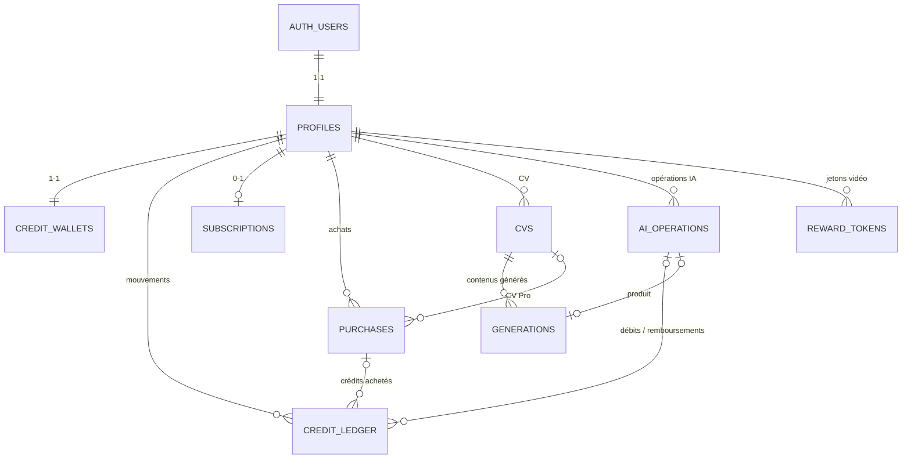

# Modèle de données — Mon CV en 30 Secondes (version Web)

> Phase 3 — rôle Database Architect. Date : 23/11/2026.
> Postgres (Supabase), RLS sur **toutes** les tables. Les migrations SQL sont écrites
> incrément par incrément (§7) dans `supabase/migrations/`, testées sur Supabase local (Docker).

---

## 1. Diagramme entité-relation

`STRIPE_EVENTS` est indépendante (journal d'idempotence, sans donnée personnelle).

---

## 2. Types énumérés

| Type | Valeurs |
|------|---------|
| `app_locale` | `fr`, `en`, `it`, `es`, `de` (ADR-018) |
| `plan_tier` | `essential`, `pro`, `premium` |
| `billing_interval` | `month`, `year` |
| `subscription_status` | `trialing`, `active`, `past_due`, `unpaid`, `canceled`, `incomplete`, `incomplete_expired`, `paused` (miroir de Stripe) |
| `subscription_source` | `stripe`, `app_store`, `play_store` (H17 : seul `stripe` est utilisé) |
| `credit_bucket` | `included`, `purchased` |
| `ledger_reason` | `ai_operation`, `ai_refund`, `pack_purchase`, `rewarded_ad`, `trial_grant`, `monthly_grant`, `upgrade_grant`, `included_expiry`, `subscription_end` |
| `purchase_product` | `credits_5`, `credits_15`, `credits_40`, `cv_pro`, `ads_removal` |
| `ai_operation_kind` | `generate_cv`, `improve_experience`, `improve_summary`, `adapt_to_job`, `linkedin`, `cover_letter`, `interview`, `interview_feedback` |
| `ai_operation_status` | `pending`, `succeeded`, `failed` |
| `generation_kind` | `summary_variants`, `job_adaptation`, `linkedin`, `cover_letter`, `interview` |

---

## 3. Dictionnaire des données

Toutes les tables ont `created_at timestamptz not null default now()` ; celles marquées (u) ont
aussi `updated_at`, mis à jour par le déclencheur `set_updated_at`.

### `profiles` (u) — un par compte
| Colonne | Type | Contraintes | Rôle |
|---------|------|-------------|------|
| `id` | uuid | PK, FK `auth.users(id)` `on delete cascade` | Identifiant du compte |
| `first_name`, `last_name` | text | null, 1 à 60 caractères | En-tête du CV (H18) |
| `phone` | text | null, ≤ 30 | Coordonnée par défaut |
| `city` | text | null, ≤ 80 | Coordonnée par défaut |
| `locale` | `app_locale` | not null, défaut `en` | Langue de l'interface (e-mails, langue du CV par défaut) |
| `stripe_customer_id` | text | unique, null | Client Stripe |
| `free_generation_used_at` | timestamptz | null | Génération gratuite consommée (H3) |
| `trial_used_at` | timestamptz | null | Essai déjà utilisé (US-21) |
| `ads_removed_at` | timestamptz | null | Retrait des pubs acheté (US-24) |
| `interstitial_shown_at` | timestamptz | null | Interstitiel déjà vu (US-34) |
| `last_seen_at` | timestamptz | not null, défaut `now()` | Dernière activité (rétention, US-40) |
| `retention_warning_sent_at` | timestamptz | null | Avertissement de suppression envoyé |

L'e-mail n'est pas dupliqué : il reste dans `auth.users`.

### `credit_wallets` (u) — soldes
| Colonne | Type | Contraintes |
|---------|------|-------------|
| `user_id` | uuid | PK, FK `profiles` `on delete cascade` |
| `included_balance` | int | not null, défaut 0, `>= 0` |
| `purchased_balance` | int | not null, défaut 0, `>= 0` |

### `credit_ledger` — journal des mouvements (ajout seul)
| Colonne | Type | Contraintes |
|---------|------|-------------|
| `id` | bigint | PK, identité |
| `user_id` | uuid | FK `profiles` `on delete cascade` |
| `bucket` | `credit_bucket` | not null |
| `delta` | int | not null, `<> 0` |
| `reason` | `ledger_reason` | not null |
| `operation_id` | uuid | null, FK `ai_operations` `on delete set null` |
| `purchase_id` | uuid | null, FK `purchases` `on delete set null` (contrainte ajoutée à l'Inc-6 avec la table) |

Invariant testé (NFR-08) : pour chaque compte et chaque solde, la somme des `delta` est égale au
solde du portefeuille. Toute mise à jour d'une ligne est bloquée par un déclencheur.

### `subscriptions` (u) — abonnement courant (au plus un par compte)
| Colonne | Type | Contraintes |
|---------|------|-------------|
| `id` | uuid | PK |
| `user_id` | uuid | FK `profiles` `on delete cascade`, **unique** |
| `source` | `subscription_source` | not null, défaut `stripe` |
| `provider_subscription_id` | text | not null, unique |
| `plan` | `plan_tier` | not null |
| `billing_interval` | `billing_interval` | not null |
| `status` | `subscription_status` | not null |
| `monthly_credits` | int | not null, `> 0` (quota copié depuis `features/plans` à chaque événement) |
| `trial_ends_at` | timestamptz | null |
| `current_period_end` | timestamptz | not null |
| `cancel_at_period_end` | boolean | not null, défaut false |
| `next_credit_grant_at` | timestamptz | null (date de la prochaine remise mensuelle) |

### `purchases` — achats uniques
| Colonne | Type | Contraintes |
|---------|------|-------------|
| `id` | uuid | PK |
| `user_id` | uuid | FK `profiles` `on delete cascade` |
| `product` | `purchase_product` | not null |
| `cv_id` | uuid | null, FK `cvs` `on delete set null` ; obligatoire à l'achat d'un `cv_pro` (vérifié par `fulfill_purchase` : le CV peut être remplacé ensuite, ADR-029) |
| `stripe_checkout_session_id` | text | not null, **unique** (idempotence) |
| `amount_cents` | int | not null, `>= 0` |
| `currency` | text | not null, défaut `eur` |
| `terms_accepted_at` | timestamptz | not null (conditions + renonciation au droit de rétractation) |

### `cvs` (u)
| Colonne | Type | Contraintes |
|---------|------|-------------|
| `id` | uuid | PK |
| `user_id` | uuid | FK `profiles` `on delete cascade` |
| `operation_id` | uuid | null, **unique**, FK `ai_operations` `on delete set null` (génération d'origine : un rejeu retrouve le CV, ADR-027) |
| `title` | text | not null, 1 à 120 (métier par défaut) |
| `language` | `app_locale` | not null (langue du contenu, des titres, du filigrane) |
| `answers` | jsonb | not null, objet (`CvAnswers`) |
| `content` | jsonb | not null, objet (`CvContent`), ≤ 64 Ko |
| `pro_unlocked_at` | timestamptz | null (CV Pro acheté) |

### `generations` (u) — contenus générés conservés avec un CV (H20)
| Colonne | Type | Contraintes |
|---------|------|-------------|
| `id` | uuid | PK |
| `user_id` | uuid | FK `profiles` `on delete cascade` |
| `cv_id` | uuid | FK `cvs` `on delete cascade` |
| `kind` | `generation_kind` | not null |
| `language` | `app_locale` | not null (langue du contenu généré) |
| `input` | jsonb | not null, défaut `{}` (poste, entreprise, annonce, réponses d'entretien) |
| `output` | jsonb | not null, ≤ 64 Ko |
| `operation_id` | uuid | null, FK `ai_operations` `on delete set null` |

### `ai_operations` — journal des opérations IA (sans le contenu)
| Colonne | Type | Contraintes |
|---------|------|-------------|
| `id` | uuid | PK |
| `user_id` | uuid | FK `profiles` `on delete cascade` |
| `request_id` | uuid | not null ; **unique** avec `user_id` (idempotence) |
| `kind` | `ai_operation_kind` | not null |
| `status` | `ai_operation_status` | not null, défaut `pending` |
| `credits_charged` | int | not null, défaut 0 |
| `was_free` | boolean | not null, défaut false |
| `model` | text | null |
| `input_tokens`, `output_tokens`, `cache_read_tokens` | int | null |
| `cost_usd_micros` | bigint | null (coût estimé en millionièmes de dollar) |
| `duration_ms` | int | null |
| `error_code` | text | null |
| `ip_hash` | text | null (IP hachée avec sel secret, effacée après 30 jours) |
| `finished_at` | timestamptz | null |

### `stripe_events` — idempotence des webhooks
| Colonne | Type | Contraintes |
|---------|------|-------------|
| `id` | text | PK (identifiant d'événement Stripe) |
| `type` | text | not null |

Purgée après 90 jours.

### `reward_tokens` — vidéos récompensées (Inc-11)
| Colonne | Type | Contraintes |
|---------|------|-------------|
| `id` | uuid | PK (le jeton) |
| `user_id` | uuid | FK `profiles` `on delete cascade` |
| `expires_at` | timestamptz | not null (création + 15 min) |
| `redeemed_at` | timestamptz | null |

---

## 4. Règles d'accès (RLS)

RLS **activée sur toutes les tables**. Le rôle `anon` n'a aucun privilège sur les tables. Les
policies comparent `(select auth.uid())` à la colonne propriétaire. « — » = refus (aucune policy,
aucun privilège) : seule l'application serveur, avec la clé secrète, écrit via les fonctions du §5.

| Table | SELECT | INSERT | UPDATE | DELETE |
|-------|--------|--------|--------|--------|
| `profiles` | propriétaire | — (déclencheur) | propriétaire, colonnes `first_name`, `last_name`, `phone`, `city`, `locale` uniquement | — (suppression du compte) |
| `credit_wallets` | propriétaire | — | — | — |
| `credit_ledger` | propriétaire | — | — | — |
| `subscriptions` | propriétaire | — | — | — |
| `purchases` | propriétaire | — | — | — |
| `cvs` | propriétaire | — (créé après génération) | propriétaire, colonnes `title`, `content` uniquement | propriétaire |
| `generations` | propriétaire | — | propriétaire, colonne `output` uniquement | — (avec le CV) |
| `ai_operations` | — | — | — | — |
| `stripe_events` | — | — | — | — |
| `reward_tokens` | — | — | — | — |

Les restrictions par colonne utilisent les privilèges Postgres (`grant update (colonnes)`) en plus
des policies. Raisons clés : un utilisateur ne doit pas pouvoir créer un CV sans génération (sinon
l'historique Pro serait contourné), ni modifier ses crédits, sa formule, son déblocage CV Pro ou
ses indicateurs (gratuité, essai, pubs).

**Tests RLS (Inc-2 et suivants, `tests/db/`, `npm run test:db`)**, pour chaque table : un visiteur anonyme ne lit rien ; un
utilisateur A ne lit ni ne modifie les lignes de B ; A ne peut modifier que les colonnes
autorisées ; les insertions et suppressions interdites échouent.

---

## 5. Fonctions et déclencheurs

Fonctions `SECURITY DEFINER` avec `search_path` vide ; `execute` retiré à `public`, `anon` et
`authenticated`, accordé au seul rôle serveur, sauf mention contraire.

| Fonction | Rôle | Incrément |
|----------|------|-----------|
| `set_updated_at()` | Déclencheur `updated_at` | Inc-2 |
| `handle_new_user()` | Déclencheur sur `auth.users` : crée `profiles` (langue reprise des métadonnées d'inscription ; prénom et nom laissés vides, confirmés à la première connexion et pré-remplis avec Google, ADR-022) et `credit_wallets` | Inc-2, complété en Inc-3 |
| `touch_last_seen()` | Met à jour `last_seen_at` du compte appelant si la dernière valeur date de plus d'un jour ; **exécutable par `authenticated`** | Inc-2 |
| `spend_credits(user_id, operation_id, cost, allow_included)` | Verrouille le portefeuille (`for update`), débite inclus puis achetés (ou achetés seulement), écrit le journal ; erreur `INSUFFICIENT_CREDITS` sinon | Inc-3 |
| `refund_operation(operation_id)` | Annule les débits d'une opération une seule fois | Inc-3 |
| `grant_credits(user_id, bucket, amount, reason, purchase_id)` | Ajoute des crédits et écrit le journal | Inc-3 |
| `set_included_credits(user_id, amount, reason)` | Porte le solde inclus à `amount` (journal : expiration du reste, puis remise) | Inc-3 |
| `prevent_ledger_update()` | Déclencheur qui refuse toute mise à jour du journal | Inc-3 |
| `begin_ai_operation(user_id, request_id, kind, cost, allow_included, try_free, rate_limit, free_ip_limit, ip_hash)` | Sous verrou du portefeuille : rejeu d'une même demande, limite par minute (`RATE_LIMITED`), gratuité de la première génération (une à la fois, plafond par IP `FREE_LIMIT_REACHED`), sinon débit | Inc-4 |
| `complete_cv_generation(operation_id, title, language, answers, content, model, tokens…, replace_cv_id, cv_limit)` | Crée le CV (en supprimant le CV remplacé, `CV_LIMIT_REACHED` au-delà du plafond), consomme la gratuité, marque l'opération réussie avec ses coûts | Inc-4 |
| `fail_ai_operation(operation_id, error_code, model, tokens…)` | Rembourse une seule fois et marque l'opération échouée | Inc-4 |
| `fulfill_purchase(user_id, product, session_id, amount_cents, currency, terms_accepted_at, credits, cv_id)` | Enregistre l'achat une seule fois par session de paiement, puis ajoute les crédits, débloque le CV Pro ou retire les publicités | Inc-6 |
| `sync_subscription(user_id, subscription_id, plan, interval, status, monthly_credits, trial_credits, period_end, cancel_at_period_end, trial_ends_at)` | État relu chez Stripe : essai (crédits d'essai, essai consommé), début ou fin d'essai (quota), montée (quota immédiat), fin (inclus à zéro), date de prochaine remise | Inc-6 |
| `complete_ai_operation(operation_id, model, tokens…, cv_id, kind, language, input, output)` | Fin réussie d'une opération IA (hors génération de CV) : coûts journalisés et, le cas échéant, contenu conservé avec le CV du même compte | Inc-7 |
| `run_monthly_grants()` | Pour chaque abonnement `active` ou `past_due` dont `next_credit_grant_at <= now()` : remise au quota, prochaine date + 1 mois | Inc-6 |
| `run_daily_maintenance()` | Efface les IP hachées de plus de 30 jours et les événements Stripe de plus de 90 jours ; rembourse les opérations IA restées « en cours » plus de 15 minutes (les jetons expirés s'ajoutent à l'Inc-11) | Inc-6 |

Planification `pg_cron` : `run_monthly_grants()` toutes les heures, `run_daily_maintenance()`
chaque jour à 3 h (heure UTC).

---

## 6. Index

| Index | Requête servie |
|-------|----------------|
| `cvs (user_id, updated_at desc, id desc)` | Historique paginé par curseur |
| `generations (cv_id, created_at desc)` | Contenus d'un CV |
| `credit_ledger (user_id, created_at desc)` | Historique des mouvements, test d'invariant |
| `credit_ledger (operation_id)` | Remboursement d'une opération |
| `ai_operations (user_id, created_at desc)` | Limites de débit |
| `ai_operations (ip_hash, created_at) where was_free` | Plafond de CV gratuits par IP |
| `subscriptions (next_credit_grant_at) where status in ('active','past_due')` | Remise mensuelle |
| `profiles (last_seen_at)` | Rétention |
| `purchases (user_id)`, `generations (user_id)`, `reward_tokens (user_id, created_at)` | Clés étrangères filtrées |

Les contraintes `unique` (`stripe_checkout_session_id`, `provider_subscription_id`,
`(user_id, request_id)`, `stripe_customer_id`) créent leur propre index.

---

## 7. Migrations par incrément

| Incrément | Migration | Contenu |
|-----------|-----------|---------|
| Inc-0 | — | `supabase init`, `config.toml` (services inutiles désactivés, limites d'e-mail, code à 6 chiffres) |
| Inc-2 | `profiles` | Table, RLS, privilèges par colonne, `set_updated_at`, `handle_new_user`, `touch_last_seen` |
| Inc-3 | `credits` | Énumérations, `credit_wallets`, `credit_ledger`, `ai_operations`, fonctions de crédits, `handle_new_user` complété |
| Inc-4 | `cvs` | Table `cvs`, RLS, index, fonctions de génération |
| Inc-6 | `billing` | `subscriptions`, `purchases`, `stripe_events`, `fulfill_purchase`, `sync_subscription`, `pg_cron`, `run_monthly_grants`, `run_daily_maintenance` |
| Inc-7 | `generations` | Table `generations`, RLS, `complete_ai_operation` |
| Inc-11 | `ads` | `reward_tokens` |

Chaque migration est rejouable depuis zéro (`npm run db:reset`) et vérifiée en CI.

**Données de développement** (`supabase/seed.sql`, reporté à l'Inc-6 avec les formules ; d'ici
là, voir le README pour ajouter des crédits à un compte local) : quatre comptes de test (sans abonnement,
Essential, Pro, Premium) avec des e-mails en `@exemple.test`, des soldes et un CV d'exemple. La
connexion se fait par code, lu dans Mailpit (`http://localhost:54324`).

---

## 8. Données personnelles et conservation

| Donnée | Finalité | Base légale | Conservation |
|--------|----------|-------------|--------------|
| E-mail, nom, téléphone, ville | Compte, en-tête du CV | Contrat | Jusqu'à la suppression du compte, ou 3 ans sans activité (avertissement 30 jours avant) |
| Réponses, CV, contenus générés | Service | Contrat | Idem |
| Mouvements de crédits, achats | Preuve des transactions | Contrat | Idem (factures conservées par Stripe selon l'obligation légale) |
| Journal des opérations IA (sans contenu) | Suivi des coûts, anti-abus | Intérêt légitime | Durée du compte ; IP hachée effacée après 30 jours |
| Événements Stripe | Idempotence | Intérêt légitime | 90 jours |
| Brouillon des 5 questions | Reprise de la saisie | — (stocké dans le navigateur) | Effacé à l'enregistrement du CV |

Sous-traitants à citer dans la politique de confidentialité : Supabase (hébergement UE), Vercel,
Anthropic (traitement des textes pour la génération), Stripe (paiement), fournisseur SMTP,
Google (publicités, après consentement).
