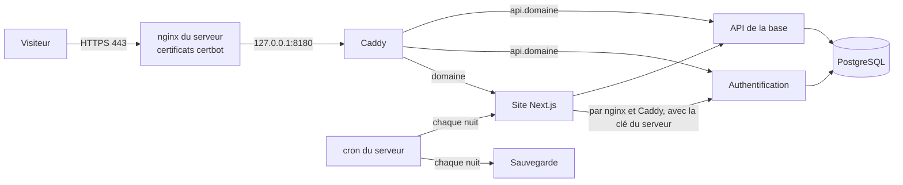

# Mise en ligne sur un VPS Hostinger

> Pas-à-pas complet pour mettre le site en ligne, puis l'exploiter : mises à jour, retour arrière,
> sauvegardes, administration. Décisions et alternatives : ADR-038 et ADR-044 (`DECISION_LOG.md`).
> Compte une demi-journée pour la première mise en ligne, hors délais des fournisseurs.

## 1. Ce qui tourne sur le serveur

Tout le site tient sur un seul VPS, dans Docker : rien n'est hébergé ailleurs (hors Stripe,
Anthropic, Google et Resend pour les e-mails). Ce VPS est le **KVM 2 existant**, qui héberge aussi
d'autres sites : comme eux, le site passe par le nginx du serveur, qui tient HTTPS (ADR-044).



| Service | Rôle | Exposé sur Internet |
|---------|------|---------------------|
| nginx (hors Docker) | HTTPS (certbot, renouvelé seul), commun aux sites du serveur | Oui : ports 80 et 443 |
| `caddy` | Aiguillage vers le site et l'API, règles d'accès, compression | Non : `127.0.0.1:8180`, derrière nginx |
| `app` | Le site (Next.js, mode serveur autonome) | Non (derrière Caddy) |
| `db` | PostgreSQL de Supabase, avec `pg_cron` (remise mensuelle des crédits) | **Non** |
| `auth` | Authentification Supabase (codes de connexion, Google) | Derrière Caddy, sous `api.domaine` |
| `rest` | API de la base (PostgREST, sous la RLS) | Derrière Caddy, sous `api.domaine` |
| `meta`, `studio` | Supabase Studio, administration de la base (à la demande) | Non : tunnel SSH seulement |

Sécurité : seuls SSH, 80 et 443 sont ouverts. L'API Supabase n'accepte que les requêtes portant la
clé du serveur du site, qui n'est jamais envoyée au navigateur. Les seules adresses ouvertes au
navigateur sont les étapes de la connexion Google. Le reste est dans `docs/security.md`.

Fichiers (dossier `deploy/`) :

| Fichier | Contenu |
|---------|---------|
| `docker-compose.yml` | Les services ci-dessus et leur configuration |
| `Dockerfile` | Image du site, construite sur le serveur |
| `Caddyfile` | Domaines, règles d'accès à l'API, adresse réelle du visiteur |
| `.env.example` | Modèle de `deploy/.env`, la configuration du serveur (jamais versionnée) |
| `supabase/roles.sql` | Mots de passe des rôles de la base, à sa création |
| `scripts/` | Préparation du serveur, secrets, déploiement, migrations, vérification, retour arrière, sauvegarde, restauration, rétention |

## 2. Avant de commencer

- **Le code est sur GitHub** : le serveur le récupère depuis le dépôt (tâche manuelle 11). Envoie
  la branche `main` (`git push origin main`) avant l'étape 5.
- **Comptes et clés prêts** : e-mails par Resend (tâche 6), Anthropic (tâche 3), Stripe activé (tâche 4),
  informations du vendeur (tâche 7), protection contre les robots Cloudflare Turnstile
  (tâche 16). Google (tâche 5) est facultatif.
- **Un terminal sur ton ordinateur** : PowerShell suffit (`ssh` et `scp` sont inclus dans
  Windows).

## 3. Étape 1 : le VPS et le domaine

Le site va sur le **VPS KVM 2 existant** (ADR-044) : passe directement au point 3. Pour un VPS
neuf (déménagement, par exemple) :

1. Sur hostinger.fr, menu **VPS** : la formule **KVM 2** (2 processeurs, 8 Go de mémoire) est
   recommandée ; **KVM 1** (4 Go) fonctionne pour démarrer, avec la mémoire d'échange créée par le
   script. Les prix varient selon la durée d'engagement : vérifie-les sur le site.
2. À l'installation du VPS :
   - **Emplacement** : un centre de données de l'**Union européenne** (France, Pays-Bas,
     Lituanie ou Allemagne), comme l'indique la politique de confidentialité du site.
   - **Système** : **Ubuntu 24.04** « simple » (sans panneau de contrôle ni application).
   - **Clé SSH** : ajoute la clé publique de l'étape 2. Si tu choisis un mot de passe root à la
     place, garde-le dans ton gestionnaire de mots de passe.
3. Note l'**adresse IP** du VPS (tableau de bord hPanel → VPS → Vue d'ensemble).
4. Achète le domaine **cv30secondes.com** (ADR-043), chez Hostinger ou un autre registraire.

## 4. Étape 2 : clé SSH de ton ordinateur

Dans PowerShell :

```powershell
ssh-keygen -t ed25519 -C "mon-ordinateur"
```

Accepte l'emplacement proposé et choisis une phrase de passe. Affiche la clé publique et copie-la
dans hPanel → VPS → **Paramètres → Clés SSH → Ajouter une clé SSH** :

```powershell
Get-Content $HOME\.ssh\id_ed25519.pub
```

Vérification : `ssh root@ADRESSE_IP` ouvre une session sur le serveur.

## 5. Étape 3 : DNS du domaine

Dans la zone DNS du domaine (hPanel → Domaines → DNS), fais pointer ces noms vers le VPS (et les
mêmes en **AAAA** vers son adresse IPv6, s'il en a une) :

| Nom | Type | Valeur |
|-----|------|--------|
| `@` | A | ADRESSE_IP |
| `www` | CNAME (ou A) | `cv30secondes.com` (ou ADRESSE_IP) |
| `api` | A | ADRESSE_IP |

Remplace les anciens enregistrements de ces noms (page de parking). La propagation prend de
quelques minutes à quelques heures. Vérification : `nslookup api.cv30secondes.com` renvoie
l'adresse du VPS.

## 6. Étape 4 : préparer le serveur (une seule fois)

Depuis la racine du projet, sur ton ordinateur :

```powershell
scp deploy/scripts/setup-vps.sh root@ADRESSE_IP:/root/
```

```powershell
ssh root@ADRESSE_IP "bash /root/setup-vps.sh cv30secondes.com"
```

Le script (5 minutes environ, relançable) installe les mises à jour de sécurité automatiques, le
pare-feu (SSH, 80, 443), la protection contre les essais de mots de passe (fail2ban), Docker,
2 Go de mémoire d'échange, l'utilisateur `deploy`, les dossiers `/opt/mon-cv` et
`/var/backups/mon-cv`, et les tâches de la nuit : sauvegarde à 3 h 15 et rétention des comptes à
4 h 30 (heure UTC). Il configure enfin **nginx** pour le domaine, `www` et `api`, et obtient leur
certificat HTTPS avec **certbot** (renouvelé automatiquement) : le DNS doit déjà pointer vers le
serveur.

Sur un **serveur neuf**, il désactive aussi la connexion SSH par mot de passe si une clé est
installée. Sur un **serveur déjà en service** (Docker présent, comme le KVM 2), il ne fait ni mise
à jour générale (elle redémarrerait les autres sites) ni changement des règles SSH. La connexion
root par mot de passe reste alors ouverte : ferme-la quand toutes tes connexions passent par une
clé.

Vérification : `ssh deploy@ADRESSE_IP` ouvre une session, et `https://cv30secondes.com` répond
« 502 » avec un certificat valide (le site n'est pas encore lancé).

## 7. Étape 5 : récupérer le code sur le serveur

Connecté en `deploy` (`ssh deploy@ADRESSE_IP`), crée une clé de lecture du dépôt :

```bash
ssh-keygen -t ed25519 -f ~/.ssh/github -N "" -C "vps-mon-cv"
printf 'Host github.com\n  IdentityFile ~/.ssh/github\n' >> ~/.ssh/config
cat ~/.ssh/github.pub
```

Sur GitHub, dépôt → **Settings → Deploy keys → Add deploy key** : colle la clé, **sans** cocher
« Allow write access ». Puis, sur le serveur :

```bash
git clone git@github.com:PROPRIETAIRE/DEPOT.git /opt/mon-cv
```

**Sur le KVM 2 (fait le 25/11/2026)** : `deploy` partage le serveur avec d'autres sites, donc
la clé de lecture porte un nom propre au site. C'est `~/.ssh/github_mon_cv`, déclarée dans le
dépôt comme « VPS KVM 2 (lecture seule) », et utilisée par l'hôte `github-mon-cv` de
`~/.ssh/config.mon-cv`. Le dépôt du serveur lit donc
`origin = git@github-mon-cv:Kelenix/Mon-cv-en-30-minutes.git`.

**Toute mise en ligne passe par GitHub** : envoyer `main`, la CI vérifie, puis le workflow
« Déploiement » lance `deploy.sh` sur le serveur (étape 9). Ne jamais déployer à la main une
version absente de GitHub. Le dépôt `/opt/mon-cv.git` du premier lancement n'est plus utilisé.

## 8. Étape 6 : configuration du serveur (`deploy/.env`)

Un `deploy/.env` préparé sur ton ordinateur (non versionné : domaine, clé Resend…) se copie
d'abord sur le serveur, depuis le dossier du projet :
`scp deploy/.env deploy@ADRESSE_IP:/opt/mon-cv/deploy/.env`. Le script ci-dessous ne remplit
que les secrets encore vides.

```bash
cd /opt/mon-cv/deploy
./scripts/generate-secrets.sh
nano .env
```

Le script crée `deploy/.env` (droits 600) et remplit les secrets techniques : mot de passe de la
base, secret JWT et clés Supabase, sel des adresses IP, jeton des tâches. Complète le reste :

| Variables | Valeur |
|-----------|--------|
| `DOMAIN`, `SUPABASE_DOMAIN`, `SMTP_SENDER_EMAIL` | Déjà remplis pour `cv30secondes.com` |
| `SMTP_PASSWORD` | Clé d'API Resend (tâche 6) ; hôte, port et identifiant Resend déjà remplis |
| `ANTHROPIC_API_KEY` | Clé Anthropic (tâche 3) |
| `STRIPE_SECRET_KEY`, `STRIPE_WEBHOOK_SECRET` | Clés du **mode réel** (étape 8). Vides : le site tourne sans paiement (ADR-045) |
| `TURNSTILE_SITE_KEY`, `TURNSTILE_SECRET_KEY` | Clés Cloudflare Turnstile (tâche 16) |
| `ADMIN_EMAILS` | Ton adresse e-mail, pour l'espace d'administration (tâche 17) |
| `LEGAL_*` | Informations du vendeur (tâche 7) : nom, e-mail, publication et hébergeur obligatoires, le reste facultatif |
| `LEGAL_HOSTING` | `Hostinger International Ltd, 61 Lordou Vironos Street, 6023 Larnaca, Chypre`, suivi du téléphone indiqué dans les mentions légales de hostinger.fr (à vérifier) |
| `GOOGLE_*`, `ADS_*` | Plus tard (étape 8, tâche 10) |

Une valeur avec des espaces ou des accents s'écrit telle quelle ; une valeur qui contient `$`
s'écrit entre apostrophes (`'...'`). Enregistre avec Ctrl+O, Entrée, puis Ctrl+X.

Ne copie jamais ce fichier ailleurs que dans ton gestionnaire de mots de passe : il donne accès à
toutes les données.

## 9. Étape 7 : premier lancement

```bash
/opt/mon-cv/deploy/scripts/deploy.sh
```

La première fois, compte 5 à 10 minutes (téléchargement des images, construction du site).
Le script récupère `origin/main`, construit l'image du site, démarre la base, l'authentification,
l'API et Caddy (derrière nginx, qui a déjà les certificats), applique les migrations, démarre le
site, puis vérifie :

```text
Vérification de https://cv30secondes.com :
  ✔ Sonde du site (200)
  ✔ Accueil (200)
  ✔ Tarifs (200)
  ✔ Tâches planifiées fermées au public (404)
  ✔ Authentification (200)
  ✔ Base de données (clé du serveur) (200)
  ✔ Profils fermés sans session (401)
  ✔ API refusée sans clé (401)
✔ Version 1a2b3c4d5e6f en ligne
```

Si le site refuse de démarrer, `docker compose logs app` (dans `/opt/mon-cv/deploy`) liste les
variables manquantes.

Puis ouvre `https://cv30secondes.com` : connexion avec un code reçu par e-mail, création d'un CV,
téléchargement du PDF.

## 10. Étape 8 : brancher les services externes

1. **Stripe (mode réel)** — fait le 25/11/2026 (tâche 4). Pour le refaire, depuis ton
   ordinateur, à la racine du projet, dans PowerShell :

   ```powershell
   $env:STRIPE_SECRET_KEY = "sk_live_..."; $env:NEXT_PUBLIC_SITE_URL = "https://cv30secondes.com"; npm run stripe:seed -- --live
   ```

   Ça crée les produits, les prix et le portail client du mode réel, sans aucun paiement. Le
   compte Stripe (Kelenix Teck) sert aussi à d'autres produits : le script ne crée ou ne modifie
   que les objets marqués `moncv` et laisse le portail par défaut du compte intact (ADR-042).
   Ferme ensuite PowerShell : la clé disparaît avec la session. Puis, dans le tableau de bord
   Stripe (mode réel) :

   - **Développeurs → Webhooks → Ajouter une destination** :
     `https://cv30secondes.com/api/stripe/webhook`, avec les événements
     `checkout.session.completed`, `checkout.session.async_payment_succeeded`,
     `customer.subscription.*` et `invoice.paid`. Les événements des autres produits du compte
     sont acceptés puis ignorés ;
   - copie son secret dans `STRIPE_WEBHOOK_SECRET` (`deploy/.env`) ;
   - vérifie le réglage du compte **Billing → Abonnements et e-mails → paiements non réussis** :
     après la dernière relance, « annuler l'abonnement » ou « marquer comme impayé » (jamais
     « laisser en retard », qui garderait l'accès). Ce réglage vaut pour tous les produits du
     compte.

2. **Google** (tâche 5, fait le 25/11/2026) : dans le client OAuth du projet Google Cloud
   `mon-cv-en-30-secondes`, ajoute l'origine `https://cv30secondes.com` et l'URI de redirection
   `https://api.cv30secondes.com/auth/v1/callback`. Dans **Branding**, renseigne la page d'accueil,
   les liens de confidentialité et des CGV, et le domaine autorisé, puis **Audience → Publier
   l'application** (sinon seuls les utilisateurs tests peuvent se connecter). Dans `deploy/.env` :
   `GOOGLE_AUTH_ENABLED=true`, `GOOGLE_CLIENT_ID`, `GOOGLE_CLIENT_SECRET` (les mêmes que dans
   `supabase/.env`).

3. Relance `deploy/scripts/deploy.sh` pour prendre en compte les nouvelles valeurs.

4. Plus tard : publicités (tâche 10), moteurs de recherche (tâche 13).

## 11. Étape 9 : déploiement automatique depuis GitHub

Une fois activé, chaque envoi sur `main` lance la CI ; si elle est verte, GitHub met en ligne
exactement cette version, avec les mêmes vérifications et le même retour automatique en cas
d'échec.

**Activé le 25/11/2026** :
- clé `github-actions-mon-cv` ajoutée à `deploy` sur le KVM 2, limitée à `deploy.sh` ;
- environnement `production` avec ses trois secrets ;
- `DEPLOY_ENABLED=true`.

La clé privée n'existe que dans les secrets GitHub : pour la changer, refaire les points 1 à 3.

1. Sur ton ordinateur, crée une clé réservée à GitHub :

   ```powershell
   ssh-keygen -t ed25519 -f $HOME\.ssh\mon-cv-github-actions -N '""' -C "github-actions"
   ```

2. Sur le serveur, en `deploy`, autorise cette clé à lancer **uniquement** le déploiement : ajoute
   à `~/.ssh/authorized_keys` une ligne de la forme suivante (`nano ~/.ssh/authorized_keys`), suivie
   du contenu de `mon-cv-github-actions.pub` :

   ```text
   command="/opt/mon-cv/deploy/scripts/deploy.sh",no-port-forwarding,no-agent-forwarding,no-X11-forwarding,no-pty ssh-ed25519 AAAA... github-actions
   ```

3. Sur GitHub, dépôt → **Settings → Environments → New environment** `production`, puis
   **Add environment secret** :
   - `VPS_HOST` : l'adresse IP du VPS ;
   - `VPS_SSH_KEY` : le contenu du fichier `mon-cv-github-actions` (clé privée) ;
   - `VPS_KNOWN_HOSTS` : le résultat de `ssh-keyscan -t ed25519 ADRESSE_IP`.

4. **Settings → Secrets and variables → Actions → Variables** : `DEPLOY_ENABLED` = `true`.

Vérification : onglet **Actions** → « Déploiement » → **Run workflow** sur `main` ; le journal
se termine par « Version … en ligne ».

## 12. Étape 10 : surveillance

- Crée une sonde gratuite (par exemple UptimeRobot) sur `https://cv30secondes.com/api/health`, avec
  alerte par e-mail.
- Les certificats sont renouvelés par certbot (tâche automatique du serveur), rien à faire.
- Une fois en ligne, refais la mesure Lighthouse sur le domaine (performance ≥ 90 attendue sur
  mobile, NFR-01).

## 13. Exploitation courante

Commandes à lancer en `deploy`, dans `/opt/mon-cv/deploy`.

| Besoin | Commande |
|--------|----------|
| Mettre en ligne `main` (ou un commit, une étiquette) | `./scripts/deploy.sh` (ou `./scripts/deploy.sh 1a2b3c4`) |
| Revenir à la version précédente (1 minute) | `./scripts/rollback.sh` (versions : `cat .deployments`) |
| Vérifier le site | `./scripts/smoke-test.sh` |
| Journaux du site, de l'authentification | `docker compose logs -f app` · `docker compose logs -f auth` |
| Journaux des tâches de la nuit | `journalctl -t mon-cv` |
| État des services | `docker compose ps` |
| Changer une valeur de `deploy/.env` | modifier le fichier, puis `./scripts/deploy.sh` |
| Lancer la rétention à la main | `./scripts/cron-retention.sh` |

Le retour arrière ne défait pas les migrations : chaque migration doit rester compatible avec la
version précédente du site (ajouter une colonne avant de s'en servir, la retirer une version
après qu'elle n'est plus utilisée).

Sur le KVM 2, une tâche de nuit d'un autre site supprime les images Docker inutilisées depuis
plus de 24 heures : au-delà, `rollback.sh` le signale, et `./scripts/deploy.sh <commit>`
reconstruit la version voulue (5 minutes environ).

**Mises à jour** : le système se met à jour seul (sécurité). Les versions de Supabase, Caddy et
Node sont fixées dans `docker-compose.yml` et le `Dockerfile` ; pour en changer, modifier les
étiquettes dans un commit, le tester en local, puis déployer. Redémarre le VPS quand Ubuntu le
demande (`cat /var/run/reboot-required` existe) : tous les services repartent seuls.

## 14. Sauvegardes et restauration

- **Chaque nuit** (3 h 15 UTC) : `backup.sh` enregistre les données des comptes, CV, crédits et
  paiements dans `/var/backups/mon-cv/donnees-AAAAMMJJ-HHMMSS.sql.gz`, gardées 14 jours. La
  structure de la base vient des migrations.
- **Hors du serveur** (à faire, recommandé) : active les sauvegardes automatiques du VPS dans
  hPanel, et copie de temps en temps la dernière sauvegarde sur ton ordinateur :

  ```powershell
  scp "deploy@ADRESSE_IP:/var/backups/mon-cv/donnees-*.sql.gz" .
  ```

  Ces fichiers contiennent des données personnelles : garde-les dans un dossier chiffré.
- **Restaurer** (perte de la base ou nouveau serveur, après les étapes 3 à 6) :

  ```bash
  ./scripts/restore.sh /var/backups/mon-cv/donnees-AAAAMMJJ-HHMMSS.sql.gz
  ```

  Le script demande de taper `RESTAURER` : il efface la base actuelle, la recrée, repasse les
  migrations, recharge les données et vérifie le site.

## 15. Espace d'administration

`https://cv30secondes.com/admin`, après connexion avec une adresse de `ADMIN_EMAILS` : vue
d'ensemble, utilisateurs (fiche, crédits offerts, suspension, suppression), revenus et moyens de
paiement, IA, provenance des visiteurs, état du système (services, tâches de la nuit,
sauvegardes, mémoire, disque) et journal des actions. Détail : ADR-040.

## 15 bis. Administration de la base (Supabase Studio)

Studio n'est jamais exposé sur Internet. Pour l'ouvrir :

```bash
docker compose --profile admin up -d
```

Puis, sur ton ordinateur :

```powershell
ssh -N -L 54323:localhost:54323 deploy@ADRESSE_IP
```

et ouvre `http://localhost:54323`. Quand tu as fini : Ctrl+C dans PowerShell, puis sur le serveur
`docker compose --profile admin stop meta studio`. Toute modification de structure passe par une
migration versionnée, jamais par Studio.

## 16. Secrets

| Secret | Où | Changer |
|--------|----|---------|
| Tous | `deploy/.env` (serveur, droits 600) et ton gestionnaire de mots de passe | Voir ci-dessous |
| Clés Stripe, Anthropic, SMTP, Google | Chez le fournisseur | Nouvelle clé chez le fournisseur, `deploy/.env`, `deploy.sh`, puis révoquer l'ancienne |
| `JWT_SECRET` (et les clés Supabase) | Généré | Vider `JWT_SECRET`, `generate-secrets.sh`, `deploy.sh` : toutes les sessions sont fermées |
| `POSTGRES_PASSWORD` | Généré | Fixé à la création de la base : ne pas le changer sans procédure dédiée |
| Clés SSH | Ton ordinateur, GitHub | Retirer la ligne de `~/.ssh/authorized_keys` |

## 17. Dépannage

| Symptôme | Cause probable | Que faire |
|----------|----------------|-----------|
| Pas de certificat, erreur HTTPS | DNS pas encore propagé, ports fermés | `nslookup`, `sudo certbot certificates`, `sudo nginx -t` ; relancer `setup-vps.sh` (étape 4) |
| « 502 Bad Gateway » | Site ou Caddy arrêté | `docker compose ps`, `docker compose logs caddy app` ; relancer `deploy.sh` |
| `deploy.sh` s'arrête sur le site | Variable manquante ou invalide | `docker compose logs app` : la liste est affichée ; corriger `deploy/.env` |
| Code de connexion non reçu | Clé Resend, domaine non vérifié (SPF, DKIM), quota du jour atteint | `docker compose logs auth` ; Resend → Domains (« Verified ») et Logs |
| « Trop de tentatives » à la connexion | Plafond d'e-mails par heure | Augmenter `AUTH_EMAILS_PER_HOUR` selon l'offre Resend |
| Paiement payé mais crédits absents | Webhook Stripe | Stripe → Webhooks → tentatives ; `STRIPE_WEBHOOK_SECRET` |
| Disque plein | Images et journaux | `docker system df`, puis `docker image prune` |
