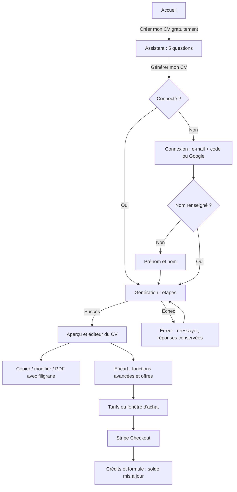

# Parcours et wireframes — Mon CV en 30 Secondes (version Web)

> Phase 3 — rôle UI/UX Designer. Date : 23/11/2026.
> Wireframes en texte (disposition ordinateur ; sur mobile, les colonnes s'empilent dans l'ordre
> indiqué). Chaque écran du MVP précise ses 4 états : chargement, vide, erreur, succès.
> Tokens et composants : `docs/design/design-system.md`.

---

## 1. Parcours principal (§14)



---

## 2. Gabarit commun

```
┌──────────────────────────────────────────────────────────────────────┐
│ [Logo Mon CV en 30 Secondes]  Tarifs  Mes CV  [⚡ 12] [FR ▾] [Compte ▾]│  ← connecté
│ [Logo]                                  Tarifs  [FR ▾]  [Se connecter]│  ← visiteur
├──────────────────────────────────────────────────────────────────────┤
│                              contenu                                 │
├──────────────────────────────────────────────────────────────────────┤
│ © Mon CV en 30 Secondes · Mentions légales · CGV · Confidentialité · │
│ Gérer les cookies · Langue : [Français ▾]                            │
└──────────────────────────────────────────────────────────────────────┘
Mobile : logo + solde + bouton menu (Sheet) contenant les liens et le choix de la langue.
Le logo et le nom de marque suivent la langue affichée (H31).
```

Le solde « ⚡ 12 » ouvre un détail : crédits inclus / crédits achetés, lien « Recharger ».

---

## 3. Écrans du MVP

### 3.1 Accueil `/` (US-01, US-02, US-03)

```
Disposition actuelle (ADR-025) : texte à gauche, illustration officielle à droite.
┌ HERO (ADR-025), plein premier écran ─────────────────────────────────┐
│ [✓ Optimisé pour les logiciels de recrutement (ATS)]                │
│ Ton CV professionnel en quelques      │  [Illustration officielle : │
│ secondes, prêt à passer les filtres   │   jeune homme à l'ordinateur,│
│ des recruteurs.                       │   CV validé, fusée, 30s]     │
│ Réponds à 5 questions : l'IA rédige…  │                              │
│ [ Créer mon CV gratuitement ]         │                              │
│ ✓ 1er CV gratuit ✓ Sans carte ✓ 5 langues                            │
└─────────────────────────────────────────────────────────────────────┘
Téléphone et tablette : le texte puis l'illustration. Version précédente, abandonnée (ADR-024) :
┌ HERO (fond blanc, touche de dégradé), tout centré (ADR-024) ────────┐
│  + +                                                        ✕       │
│  + +          Crée ton CV professionnel                             │
│  + +          en quelques secondes grâce à l'IA.                    │
│            Réponds à 5 questions, l'IA rédige ton CV.               │
│                                                                     │
│                  [ Créer mon CV gratuitement ]          ⟋           │
│      ○       ✓ 1er CV gratuit · ✓ 5 questions · ✓ Sans carte        │
│                                        |||||          ◠◠            │
└─────────────────────────────────────────────────────────────────────┘
Formes décoratives (grille de « + », croix, anneau, trait arrondi, traits, arcs) : couleurs de
la charte, sans animation, réparties sur toute la largeur ; sur mobile, seules la croix et les
arcs restent (aucun chevauchement avec le texte).
La section remplit tout le premier écran sous l'en-tête, quel que soit l'écran (téléphone,
tablette, portable, écran 4K, fenêtre large et basse), contenu centré verticalement et
entièrement visible. Le titre est proportionnel à la fenêtre : de 36 px (téléphone) à 128 px
(très grand écran), limité par la hauteur ; il garde le même découpage en trois lignes en
français à partir de 640 px (vérifié de 375×812 à 2560×1440).
┌ FONCTIONNALITÉS (fond surface) : 6 cartes, 3×2 ordinateur, 1 colonne mobile ┐
│ Création avec IA · Amélioration des expériences · Adaptation à une offre ·  │
│ Lettres de motivation · Version LinkedIn · Simulation d'entretien           │
│ (les 5 dernières : mention « avec crédits ou abonnement »)                  │
└─────────────────────────────────────────────────────────────────────────────┘
┌ OFFRES : Gratuit · Crédits IA · Essential · Pro [Recommandé] · Premium · CV Pro ┐
│ prix « à partir de », lien [Voir tous les tarifs]                                │
└──────────────────────────────────────────────────────────────────────────────────┘
┌ APPEL FINAL : « Ton CV est prêt en quelques secondes » [Créer mon CV gratuitement] ┐
```

- Chargement : page statique, pas d'état de chargement ; images avec dimensions réservées.
- Vide : sans objet.
- Erreur : sans objet (page statique) ; erreur de rendu → `error.tsx` générique.
- Succès : contenu ci-dessus. Inc-11 : bannière en bas de page pour les ayants droit.

### 3.2 Tarifs `/tarifs` (US-03)

```
Titre : Choisis la formule qui te ressemble
[ Mensuel | Annuel (jusqu'à −52 %) ]
┌ Essential ──────┐ ┌ Pro [Recommandé] ──┐ ┌ Premium ────────┐
│ 3,99 € / mois   │ │ 6,99 € / mois      │ │ 9,99 € / mois   │
│ 20 crédits/mois │ │ 60 crédits/mois    │ │ 150 crédits/mois│
│ ✓ PDF et DOCX   │ │ ✓ tout Essential   │ │ ✓ tout Pro      │
│ ✓ LinkedIn      │ │ ✓ adaptation, mots │ │ ✓ priorité      │
│ ✓ 3 variantes   │ │   -clés, lettres,  │ │   maximale      │
│ ✗ adaptation…   │ │   entretien        │ │                 │
│ [Choisir]       │ │ [Essayer 3 jours]  │ │ [Choisir]       │
└─────────────────┘ └────────────────────┘ └─────────────────┘
Essai gratuit de 3 jours (Pro). Renouvellement automatique. Annulable à tout moment.
┌ Sans abonnement ──────────────────────────────────────────────┐
│ Packs : 5 crédits 2,99 € · 15 crédits 6,99 € · 40 crédits 14,99 € │
│ CV Pro (un CV, PDF + DOCX sans filigrane) 4,99 €                  │
│ Retrait des publicités 2,99 € (si activé, Inc-11)                 │
└────────────────────────────────────────────────────────────────┘
Tableau comparatif complet (matrice des droits) · Coût de chaque opération en crédits
```

Mobile : cartes empilées, Pro en premier. Bouton d'un visiteur → connexion puis paiement.
États : statique ; bouton en chargement pendant la création de la session Stripe ; erreur
`PAYMENT_ERROR` sous le bouton.

### 3.3 Assistant `/creer` (US-10)

```
Question 2 sur 5  [■■□□□]
Tes expériences professionnelles
Aide : postes, entreprises, dates et missions principales. Écris librement.
Exemple ▸ (dépliable)
┌──────────────────────────────────────────────┐
│                                              │  1 240 / 2 000
└──────────────────────────────────────────────┘
[← Précédent]                         [Suivant →]
(question 5 : Langue du CV [Français ▾]  puis  [Générer mon CV ⚡])
```

Les réponses peuvent être écrites dans n'importe quelle langue ; la langue du CV est réglée par
défaut sur celle de l'interface (H30).

- Chargement : aucun appel serveur ; brouillon relu depuis le navigateur.
- Vide : question 1 vide → bouton Suivant désactivé avec message « Indique le métier visé » ;
  réponses 2 à 5 trop courtes → message d'incitation non bloquant.
- Erreur : dépassement de longueur → message sous le champ.
- Succès : passage à la question suivante ; à la fin, `/creer/generation`.
- Aucune publicité, aucune offre (US-10, §13).

### 3.4 Connexion `/connexion` (US-04)

```
Connecte-toi pour enregistrer ton CV
[ G  Continuer avec Google ]
──────── ou ────────
E-mail [______________]  [Recevoir un code]
→ Code envoyé à a…@exemple.fr  [_ _ _ _ _ _]  [Valider]  Renvoyer le code (60 s)
Tes réponses sont conservées.
```

Première connexion sans nom : « Comment t'appelles-tu ? » Prénom [__] Nom [__] [Continuer].

- Chargement : boutons en chargement.
- Vide : e-mail vide → message « Saisis une adresse e-mail valide » (le bouton reste actif pour
  ne jamais perdre une saisie faite avant que la page soit interactive, ADR-024).
- Erreur : e-mail invalide, code invalide ou expiré, trop de demandes (`RATE_LIMITED`).
- Succès : redirection vers `next`.

### 3.5 Génération `/creer/generation` (US-11)

```
✓ Analyse de tes réponses
◌ Rédaction de ton CV…          (étape annoncée aux lecteurs d'écran)
○ Mise en forme
« Ton CV arrive dans quelques secondes. »
```

- Chargement : étapes ci-dessus, affichées en moins de 300 ms.
- Vide : brouillon absent → retour à `/creer` avec message « Commence par répondre aux
  questions ».
- Erreur : `AI_UNAVAILABLE` → « La génération n'a pas abouti. Tes crédits ont été rendus. »
  [Réessayer] [Modifier mes réponses] ; `INSUFFICIENT_CREDITS` → fenêtre §3.8 ;
  `CV_LIMIT_REACHED` → fenêtre §3.9 ; `FREE_LIMIT_REACHED` → message + offres.
- Succès : redirection vers `/cv/{id}`, brouillon effacé.

### 3.6 Aperçu et éditeur `/cv/[id]` (US-12 à US-17, US-19)

```
┌ Barre d'actions ────────────────────────────────────────────────────┐
│ [Copier le texte] [Télécharger le PDF] [DOCX 🔒 ou DOCX]  Enregistré ✓│
└─────────────────────────────────────────────────────────────────────┘
┌ CV (feuille A4, colonne principale) ───────┐ ┌ Panneau latéral ─────────┐
│ CAMILLE DUPONT                     ✎       │ │ Encart (1re génération) : │
│ Développeuse web · Lyon · 06… · mail       │ │ « Va plus loin »          │
│ Accroche …                         ✎       │ │ Adapter à une offre,      │
│ EXPÉRIENCES                        ＋      │ │ lettre, LinkedIn,         │
│  Développeuse — Société, 2021–Aujourd'hui  │ │ entretien                 │
│  • …                               ✎ ↑↓ 🗑 │ │ [Voir les offres]  [×]    │
│ COMPÉTENCES  …                     ✎       │ │ CV Pro 4,99 € : PDF et    │
│ FORMATION    …                     ✎       │ │ DOCX sans filigrane       │
│ LANGUES      …                     ✎       │ │ [Débloquer ce CV]         │
└────────────────────────────────────────────┘ └──────────────────────────┘
```

Mobile : barre d'actions fixe en bas (Copier, PDF, Plus…), panneau sous le CV.
Les outils IA (Inc-7 à Inc-9) s'ajoutent en onglets ; ils n'apparaissent pas avant d'exister.
Toute la page est en pleine largeur ; sans offre à proposer (Premium, CV débloqué), le CV
occupe toute la largeur.

Onglets des outils (« Adapter à une offre », « LinkedIn », « Lettre de motivation ») :

```
┌ Formulaire (2/5) ─────────────┐ ┌ Résultat (3/5) ───────────────────────────────┐
│ Champs, langue                │ │ Avant la 1re génération : cadre pointillé     │
│ [Générer — n crédits]         │ │ « Tes textes … apparaîtront ici. »            │
│ Versions précédentes          │ │ Ensuite : textes modifiables, [Copier]        │
└───────────────────────────────┘ └───────────────────────────────────────────────┘
```

Mobile : formulaire puis résultat, l'un sous l'autre (pas de cadre vide).

- Chargement : squelette de la feuille A4.
- Vide : sans objet (un CV a toujours un contenu) ; section vide → « Ajoute une expérience ».
- Erreur : CV absent ou d'un autre compte → page 404 « Ce CV est introuvable » + lien vers mes
  CV ; échec d'enregistrement → « Modification non enregistrée » [Réessayer], contenu conservé.
- Succès : « Enregistré ✓ » ; « Copié » ; téléchargement lancé.

### 3.7 Crédits et formule `/compte/credits` (US-07, US-18 à US-23)

```
Ta formule : Pro (mensuelle) · renouvelée le 23 décembre 2026   [Gérer mon abonnement]
┌ Crédits ──────────────────────────────────────────────┐
│ ⚡ 42 au total  ·  Inclus : 30 (remis à 60 le 23/12)  ·  Achetés : 12 │
└───────────────────────────────────────────────────────┘
Recharger : [5 crédits 2,99 €] [15 crédits 6,99 €] [40 crédits 14,99 €]
Coût des opérations : tableau du §11.1
Achats : CV Pro (CV « Développeuse web »), …
```

Sans abonnement : « Aucun abonnement » + cartes des formules + [Essayer Pro 3 jours].

- Chargement : squelette ; retour de paiement → « Paiement reçu, mise à jour de ton solde… »
  (interrogation 10 s maximum).
- Vide : aucun achat → section masquée.
- Erreur : délai de 10 s dépassé → « Ton paiement est bien reçu ; le solde s'actualisera dans
  quelques instants » [Actualiser] ; paiement annulé → « Paiement annulé, rien n'a été débité ».
- Succès : solde à jour + toast.

### 3.8 Fenêtre « Solde insuffisant » (US-08, US-09)

```
Il te manque 1 crédit pour « Adapter à une offre » (2 crédits).
Ton solde : 1 crédit.
[15 crédits — 6,99 €] [40 crédits — 14,99 €] [Passer en Pro — 60 crédits/mois]
(Inc-11 : [Regarder une annonce pour 1 crédit])          [Annuler]
```

Variante Essential sur une fonction réservée : « Avec Essential, cette fonction se paie en
crédits achetés. » + packs + [Passer en Pro].

### 3.9 Fenêtre « Remplacer un CV » (H22, US-31)

```
Ta formule conserve 1 CV. Le nouveau CV remplacera :
(•) Développeuse web — modifié le 20/11/2026   ⚠ débloqué en CV Pro : ce déblocage sera perdu
[Remplacer et générer]   [Passer en Pro pour tout garder]   [Annuler]
```

### 3.10 Compte `/compte` (US-05, US-06)

```
Mes informations : Prénom [__] Nom [__] Téléphone [__] Ville [__]  [Enregistrer]
E-mail : a…@exemple.fr (non modifiable)
Formule et crédits → /compte/credits
[Se déconnecter]
Zone sensible : [Supprimer mon compte]
→ AlertDialog : liste de ce qui sera perdu ; saisir SUPPRIMER ; [Supprimer définitivement]
```

- Chargement : squelette ; boutons en chargement.
- Vide : champs facultatifs vides acceptés.
- Erreur : validation par champ ; échec de suppression → message + aucune donnée supprimée.
- Succès : « Informations enregistrées » ; suppression → accueil avec « Ton compte a été
  supprimé ».

### 3.11 Pages légales (US-38)

Texte structuré, sommaire ancré, date de mise à jour. Statiques.

---

## 4. Écrans du lot V1 (détaillés dans leur incrément)

| Écran | Points clés |
|-------|-------------|
| Historique `/cv` (Inc-10) | Liste de cartes (titre, date) ; vide : illustration + « Crée ton premier CV » ; pagination « Charger plus » ; bannière et publicité native pour les ayants droit |
| Améliorer une expérience (Inc-7) | Bouton par expérience ; comparaison avant / après ; [Remplacer] [Garder l'original] |
| Accroche (Inc-7) | Liste de 3 ou 5 variantes à choisir |
| Adapter à une offre (Inc-7) | Champ annonce ; résultat côte à côte ; mots-clés manquants en badges ; [Appliquer] [Enregistrer comme nouveau CV] |
| LinkedIn (Inc-8) | Blocs titre / Infos / expériences, chacun avec [Copier] et compteur de caractères |
| Lettre (Inc-8) | Poste, entreprise, annonce ; lettre modifiable ; [Copier] |
| Entretien (Inc-9) | Poste et langue à gauche ; à droite, les 8 questions listées, chacune avec son champ de réponse ; [Obtenir mon retour — gratuit] ; puis, par question : réponse, points forts, à améliorer, exemple (ADR-032) |
| Bandeau de consentement (Inc-11) | Plateforme certifiée Google ; Accepter / Refuser au même niveau ; dans la langue affichée |
| Langue des contenus (Inc-7 à 9) | Chaque outil affiche « Langue » réglée sur celle du CV, modifiable avant de générer |
| Vidéo récompensée (Inc-11) | Bouton dans les crédits et la fenêtre §3.8 ; compteur « 2 sur 3 aujourd'hui » |
