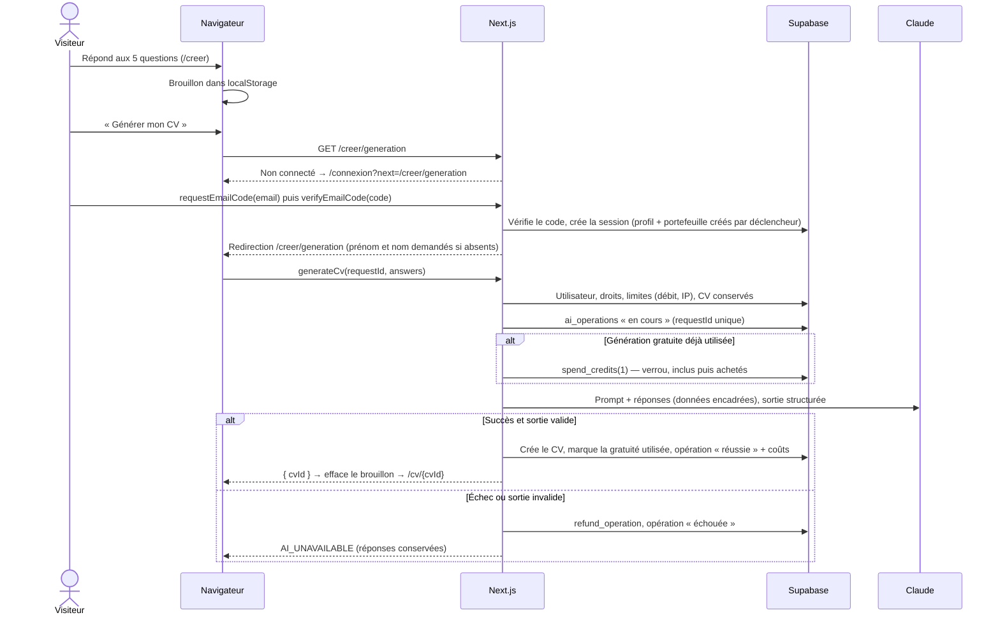
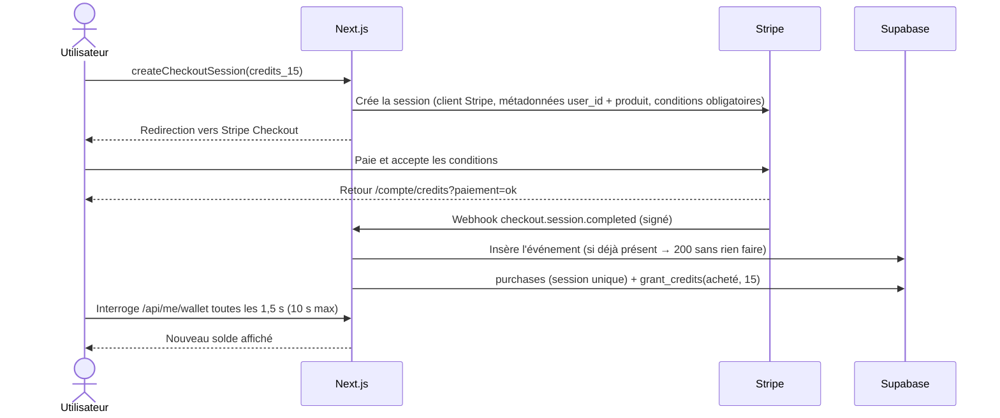
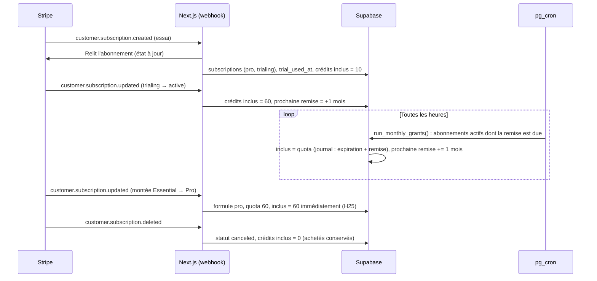
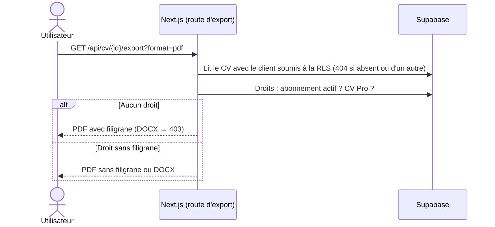
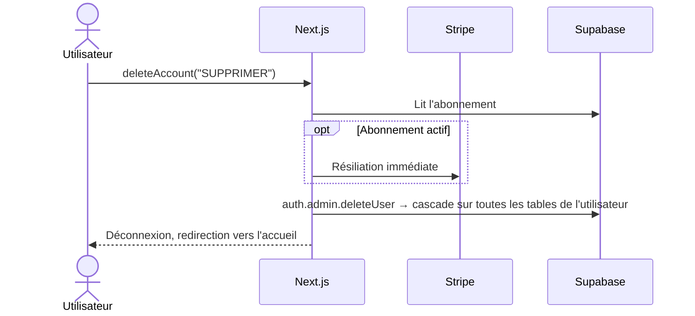

# System design — Mon CV en 30 Secondes (version Web)

> Phase 3 — rôle System Design. Date : 23/11/2026.
> Contrats des actions et routes, flux critiques, cache, pagination, résilience.
> Architecture : `docs/architecture.md`. Données : `docs/data-model.md`.

---

## 1. Format commun des réponses

Toute Server Action renvoie :

```ts
type ActionResult<T> =
  | { ok: true; data: T }
  | { ok: false; error: { code: ErrorCode; message: string; details?: Record<string, string> } };
```

Une action qui termine par une redirection (`redirect()`) ne renvoie rien en cas de succès.
Toute entrée est validée par un schéma Zod partagé entre le formulaire et le serveur ; le serveur
revalide toujours.

## 2. Codes d'erreur

Les messages sont traduits dans les 5 langues (clé de traduction = code d'erreur) ; exemples en
français ci-dessous.

| Code | Sens | Message affiché (exemple) |
|------|------|---------------------------|
| `UNAUTHENTICATED` | Session absente ou expirée | « Ta session a expiré. Reconnecte-toi pour continuer. » |
| `FORBIDDEN` | Ressource d'un autre utilisateur ou action interdite | « Tu n'as pas accès à ce contenu. » |
| `VALIDATION_ERROR` | Entrée invalide (`details` par champ) | « Vérifie les champs signalés. » |
| `NOT_FOUND` | Ressource absente | « Ce CV est introuvable. » |
| `FEATURE_LOCKED` | Fonction non incluse dans les droits | « Cette fonction se débloque avec Pro ou avec des crédits achetés. » |
| `INSUFFICIENT_CREDITS` | Solde insuffisant | « Il te manque des crédits pour cette action. » |
| `CV_LIMIT_REACHED` | Nombre de CV conservés atteint (H12, H22) | « Choisis le CV à remplacer. » |
| `RATE_LIMITED` | Trop d'opérations rapprochées | « Patiente quelques secondes avant de relancer. » |
| `FREE_LIMIT_REACHED` | Plafond de CV gratuits par adresse IP atteint (H27) | « Limite de CV gratuits atteinte pour aujourd'hui. » |
| `AI_UNAVAILABLE` | Erreur ou délai dépassé côté IA (crédits rendus) | « La génération n'a pas abouti. Tes crédits ont été rendus. Réessaie. » |
| `AI_INVALID_OUTPUT` | Réponse IA invalide après contrôle (crédits rendus) | Même message |
| `CONFLICT` | État incompatible (déjà abonné, essai déjà utilisé, jeton déjà utilisé…) | Message propre au cas |
| `PAYMENT_ERROR` | Stripe indisponible | « Le paiement est momentanément indisponible. » |
| `INTERNAL` | Erreur inattendue (journalisée avec un identifiant) | « Une erreur est survenue. Réessaie dans un instant. » |

---

## 3. Contrats des Server Actions

`requestId` : identifiant (uuid) généré par le navigateur à chaque clic ; il rend les opérations
IA idempotentes (un double clic ou un rejeu ne débite qu'une fois).

### Authentification et profil (Inc-2)

| Action | Entrée | Sortie | Erreurs |
|--------|--------|--------|---------|
| `requestEmailCode` | `email`, `next?` (chemin interne) | `{ sent: true }` | `VALIDATION_ERROR`, `RATE_LIMITED` |
| `verifyEmailCode` | `email`, `code` (6 chiffres), `next?` | redirection vers `next` ou `/compte` | `VALIDATION_ERROR` (« Code invalide ou expiré ») |
| `signInWithGoogle` | `next?` | redirection vers Google | `INTERNAL` |
| `signOut` | — | redirection vers `/` | — |
| `updateProfile` | `firstName`, `lastName` (1 à 60), `phone?` (≤ 30), `city?` (≤ 80) | profil | `UNAUTHENTICATED`, `VALIDATION_ERROR` |
| `deleteAccount` | `confirmation` = « SUPPRIMER » | redirection vers `/?compte=supprime` | `UNAUTHENTICATED`, `VALIDATION_ERROR`, `PAYMENT_ERROR` |

`next` n'accepte que des chemins internes commençant par `/` (pas de redirection ouverte).

### CV (Inc-4, Inc-10)

| Action | Entrée | Sortie | Erreurs |
|--------|--------|--------|---------|
| `generateCv` | `requestId`, `answers` (voir §4), `language` (langue du CV, défaut : langue de l'interface), `replaceCvId?` | `{ cvId }` | `UNAUTHENTICATED`, `VALIDATION_ERROR`, `CV_LIMIT_REACHED` (avec la liste des CV), `INSUFFICIENT_CREDITS`, `RATE_LIMITED`, `FREE_LIMIT_REACHED`, `AI_UNAVAILABLE`, `AI_INVALID_OUTPUT` |
| `updateCv` | `cvId`, `content` (schéma `CvContent`) | `{ updatedAt }` | `UNAUTHENTICATED`, `VALIDATION_ERROR`, `NOT_FOUND` |
| `deleteCv` | `cvId` | `{ deleted: true }` | `UNAUTHENTICATED`, `NOT_FOUND` |

### Outils IA (Inc-7 à Inc-9)

Toutes : `UNAUTHENTICATED`, `VALIDATION_ERROR`, `NOT_FOUND`, `FEATURE_LOCKED`,
`INSUFFICIENT_CREDITS`, `RATE_LIMITED`, `AI_UNAVAILABLE`, `AI_INVALID_OUTPUT`.
Toutes les actions qui génèrent du texte acceptent `language?` (défaut : langue du CV, H30).

| Action | Entrée | Sortie | Coût |
|--------|--------|--------|------|
| `improveExperience` | `requestId`, `cvId`, `experienceId` | `{ proposal }` (expérience réécrite) | 1 |
| `improveSummary` | `requestId`, `cvId` | `{ generationId, variants }` (3 ou 5) | 1 |
| `adaptToJob` | `requestId`, `cvId`, `jobPosting` (50 à 10 000) | `{ generationId, adaptedContent, missingKeywords }` | 2 |
| `applyAdaptation` | `generationId`, `mode` : `replace` \| `new` | `{ cvId }` (+ `FORBIDDEN` si `new` hors Pro/Premium) | 0 |
| `generateLinkedin` | `requestId`, `cvId` | `{ generationId, headline, about, experiences }` | 1 |
| `generateCoverLetter` | `requestId`, `cvId`, `position` (2 à 120), `company?`, `jobPosting?` | `{ generationId, letter }` | 2 |
| `startInterview` | `requestId`, `cvId`, `position` | `{ generationId, questions }` (8) | 2 |
| `submitInterviewAnswers` | `generationId`, `answers[]` (≤ 2 000 chacune) | `{ feedback }` (+ `CONFLICT` si déjà évalué) | 0 |
| `updateGeneratedContent` | `generationId`, `output` | `{ updatedAt }` | 0 |

### Paiements (Inc-6, Inc-11)

| Action | Entrée | Sortie | Erreurs |
|--------|--------|--------|---------|
| `createCheckoutSession` | `product` (lookup key), `cvId?` (obligatoire pour `cv_pro`), `withTrial?` | `{ url }` | `UNAUTHENTICATED`, `VALIDATION_ERROR`, `CONFLICT` (déjà abonné, essai déjà utilisé, pubs déjà retirées, CV déjà Pro), `FORBIDDEN` (retrait des pubs désactivé), `PAYMENT_ERROR` |
| `openBillingPortal` | — | `{ url }` | `UNAUTHENTICATED`, `NOT_FOUND` (aucun client Stripe), `PAYMENT_ERROR` |

### Publicités (Inc-11)

| Action | Entrée | Sortie | Erreurs |
|--------|--------|--------|---------|
| `issueRewardToken` | — | `{ token }` | `UNAUTHENTICATED`, `FORBIDDEN` (abonné), `RATE_LIMITED` (3 par jour) |
| `redeemRewardToken` | `token` | `{ purchasedBalance }` | `UNAUTHENTICATED`, `CONFLICT` (déjà utilisé ou expiré) |
| `markInterstitialShown` | — | `{ ok: true }` | `UNAUTHENTICATED` |

## 4. Schémas de données partagés

```ts
// Langues proposées (ADR-018)
Locale = "fr" | "en" | "it" | "es" | "de";

// Réponses aux 5 questions (H19), dans n'importe quelle langue
CvAnswers = {
  job: string;          // 2 à 2 000, obligatoire
  experiences: string;  // 0 à 2 000
  skills: string;       // 0 à 2 000
  education: string;    // 0 à 2 000
  goal: string;         // 0 à 2 000
};

// Contenu structuré du CV (sortie de l'IA, puis modifié par l'utilisateur)
CvContent = {
  header: { fullName: string; title: string; email?: string; phone?: string; city?: string };
  summary: string;                                   // ≤ 600
  experiences: {                                     // ≤ 15
    id: string; role: string; company: string; location?: string;
    startDate?: string; endDate?: string;            // texte libre (« 2021 », « Aujourd'hui »)
    bullets: string[];                               // ≤ 8, chacune ≤ 300
  }[];
  skills: string[];                                  // ≤ 40, chacune ≤ 60
  education: { id: string; degree: string; school: string; year?: string; details?: string }[]; // ≤ 10
  languages: { id: string; name: string; level?: string }[];                                     // ≤ 10
};
```

Les dates restent du texte libre : l'IA ne doit pas inventer de mois ou d'année absents des
réponses (R05). La langue du contenu est stockée à côté (`cvs.language`) ; les titres de sections
(« Expériences », « Experience », « Esperienze »…) viennent des traductions de l'application.

## 5. Route Handlers

| Route | Méthode | Entrée | Réponse | Erreurs |
|-------|---------|--------|---------|---------|
| `/auth/callback` | GET | `code`, `next?` | redirection | redirection vers `/connexion?erreur=…` |
| `/api/cv/[id]/export` | GET | `format` = `pdf` \| `docx` | fichier en pièce jointe (`CV-Prénom-Nom.pdf`) | 400 format, 401, 403 (`docx` sans droit), 404 |
| `/api/me/wallet` | GET | — | `{ included, purchased, plan, nextGrantAt, renewsAt }` | 401 |
| `/api/stripe/webhook` | POST | corps brut + en-tête de signature | 200 | 400 signature invalide ; 500 → Stripe réessaie |
| `/api/cron/retention` | GET | `Authorization: Bearer CRON_SECRET` | `{ warned, deleted }` | 401 |

---

## 6. Flux critiques

### 6.1 Créer son premier CV (US-10, US-04, US-11)



### 6.2 Acheter un pack de crédits (US-18)



### 6.3 Abonnement, essai et remise mensuelle (US-20, US-21, US-23)



### 6.4 Exporter le CV (US-16, US-17)



### 6.5 Supprimer son compte (US-06)



### 6.6 Rétention des comptes inactifs (US-40)

```mermaid
sequenceDiagram
  participant V as Vercel Cron (quotidien)
  participant N as /api/cron/retention
  participant DB as Supabase
  participant M as SMTP
  V->>N: GET + CRON_SECRET
  N->>DB: Comptes sans abonnement actif, dernière activité < aujourd'hui − 3 ans + 30 j, non avertis
  N->>M: E-mail d'avertissement ; enregistre la date d'envoi
  N->>DB: Comptes avertis depuis ≥ 30 j et toujours inactifs
  N->>DB: auth.admin.deleteUser (cascade)
```

---

## 7. Cache et fraîcheur des données

| Donnée | Stratégie |
|--------|-----------|
| Accueil, tarifs, pages légales | Générées au build ; changent uniquement à un nouveau déploiement |
| Données d'un utilisateur (CV, crédits, formule) | Rendu dynamique à chaque requête, jamais mises en cache partagé |
| Après une mutation | `revalidatePath` de la page concernée, ou `router.refresh()` côté client |
| Solde affiché après une opération IA | Renvoyé par l'action, injecté dans le cache TanStack Query `['wallet']` |
| Solde après un paiement | Requête `['wallet']` interrogée toutes les 1,5 s pendant 10 s au maximum |
| Éditeur de CV | Enregistrement automatique 1 s après la dernière frappe (mutation TanStack Query), indicateur « Enregistrement… / Enregistré » |

## 8. Pagination et tri

Seule liste qui grandit : l'historique des CV (Pro, Premium). Pagination **par curseur**
(`updated_at` décroissant, puis `id`), 20 éléments par page, bouton « Charger plus ».
Les contenus générés d'un CV sont listés du plus récent au plus ancien, 20 par page.

## 9. Résilience

| Point | Règle |
|-------|-------|
| Appels IA | Délai maximal 60 s ; une nouvelle tentative sur erreur transitoire (429, 5xx, réseau) ; jamais sur 4xx |
| Opérations IA | `requestId` unique en base → aucun double débit ; crédits rendus automatiquement en cas d'échec |
| Webhooks Stripe | Signature vérifiée ; identifiant d'événement unique ; état relu depuis Stripe (ordre des événements indifférent) ; réponse 500 en cas d'erreur pour que Stripe réessaie |
| Achats | Identifiant de session Checkout unique dans `purchases` |
| Remise mensuelle | Condition sur la date de prochaine remise ; rejouable sans effet |
| Rétention | Avertissement et suppression conditionnés par des dates stockées ; rejouables |
| Appels Stripe sortants | Délai 20 s, deux nouvelles tentatives (SDK) |

## 10. Limites de débit

| Statut | Opérations IA par minute |
|--------|--------------------------|
| Sans abonnement | 3 |
| Essential | 5 |
| Pro (et essai) | 10 |
| Premium | 20 |

Calculées à partir de `ai_operations` (aucun service supplémentaire). Générations gratuites :
3 par jour et par adresse IP hachée (H27). Codes e-mail : limites de Supabase Auth, réglées dans
`supabase/config.toml`.

## 11. États d'écran

Chaque vue gère quatre états (chargement, vide, erreur, succès), spécifiés écran par écran dans
`docs/design/flows.md`.
